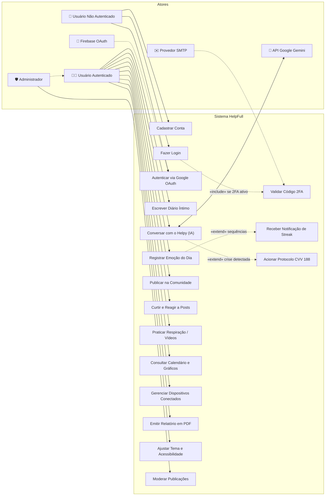
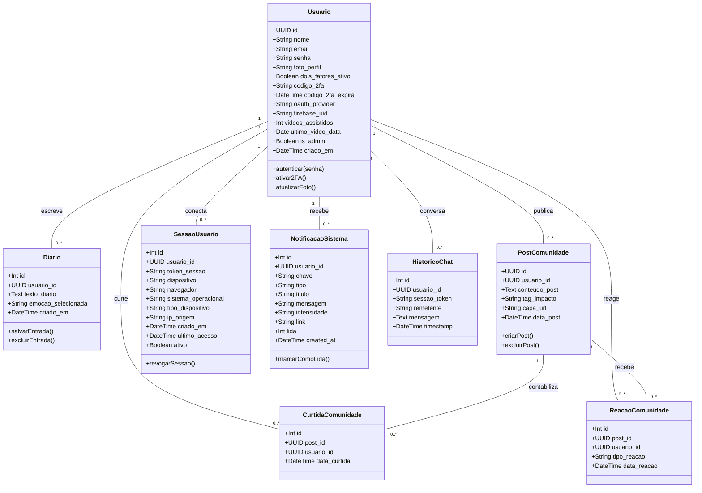

# HELPFULL — DOCUMENTAÇÃO COMPLETA DE ENGENHARIA DE SOFTWARE E SISTEMA

**Projeto:** HelpFull (HelpFull 2.0)  
**Domínio:** Plataforma Web de Saúde Mental, Autocuidado Preventivo e Apoio Mútuo  
**Ambiente de Execução:** PHP 8.2+, PostgreSQL 15+ (Supabase), Vercel Serverless / Apache (XAMPP)  
**Data do Documento:** Outubro de 2026  

---

## SUMÁRIO EXECUTIVO

O **HelpFull** é uma aplicação web progressiva desenvolvida para proporcionar um ambiente seguro, privado e acolhedor focado na saúde mental preventiva, na autorreflexão e no suporte emocional cotidiano. O sistema reúne funcionalidades de diário íntimo com registro de emoções, inteligência artificial empática com salvaguardas éticas e direcionamento de emergência (CVV 188), comunidade moderada de acolhimento mútuo, biblioteca de atividades e vídeos de regulação emocional, notificações inteligentes baseadas em tendências de humor, auditoria multi-dispositivo e emissão de relatórios mensais de acompanhamento psicológico.

Este documento consolida a especificação técnica completa, requisitos, modelagem UML, mapeamento relacional, arquitetura de software, matriz de rastreabilidade de testes e checklist de reprodutibilidade, atendendo na íntegra aos critérios metodológicos de documentação e TCC em Engenharia de Software.

---

# SEÇÃO 1: MATERIAIS — AMBIENTE E FERRAMENTAS

### 1.1 Hardware Utilizado no Desenvolvimento
* **Processador:** Intel Core i5 / AMD Ryzen 5 (ou superior), arquitetura x86_64
* **Memória RAM:** 8 GB DDR4 (recomendado: 8 GB a 16 GB)
* **Armazenamento:** 256 GB SSD NVMe (espaço ocupado pelo projeto e dependências: ~150 MB)
* **Sistema Operacional:** Windows 11 Pro 64-bit

### 1.2 Backend e Linguagem de Programação
* **Linguagem:** PHP 8.2.x (suporte a tipos estritos, arrow functions e atributos)
* **Conector de Dados:** Extensão nativa `PDO_PGSQL` (PHP Data Objects para PostgreSQL)
* **Bibliotecas e Extensões PHP:**
  - `ext-pdo` / `ext-pdo_pgsql`: Comunicação transacional e segura contra SQL Injection
  - `ext-curl`: Integração com APIs externas (Google Gemini, Firebase Auth, Google News RSS, YouTube)
  - `ext-json`: Manipulação de requisições e respostas REST assíncronas
  - `ext-zlib`: Compressão de payload de saída HTTP (otimização para Vercel Serverless)
  - `ext-mbstring` e `ext-openssl`: Criptografia e funções hash HMAC SHA-256

### 1.3 Banco de Dados
* **SGBD:** PostgreSQL 15+ hospedado na infraestrutura de nuvem **Supabase**
* **Região do Cluster:** São Paulo, Brasil (`sa-east-1`) para latência mínima (<30ms)
* **Pool de Conexões:** Supabase Session Pooler (PgBouncer na porta `5432` / pooler `6543`)
* **Dialeto e Tipos:** Suporte nativo a `UUID`, `TIMESTAMPTZ`, `JSONB`, índices únicos parciais e chaves estrangeiras com regras `ON DELETE CASCADE`

### 1.4 Frontend e Interface com o Usuário
* **Estrutura:** HTML5 Semântico (`<main>`, `<header>`, `<nav>`, `<section>`, `<article>`)
* **Estilização:** CSS3 Vanilla Moderno com variáveis CSS (`--variaveis`), Grid Layout, Flexbox, efeito *Glassmorphism* com `backdrop-filter: blur(25px)` e animações baseadas em Curvas de Bézier
* **Tipografia:** Google Fonts — Família *Montserrat* (pesos 400 a 900)
* **Comportamento e Dinamismo:** JavaScript Moderno (ES6+) assíncrono puro (Vanilla JS), com renderização de Canvas animado com partículas fluidas reativas ao cursor (`assets/fundo-animado.js`), comunicação AJAX (`fetch`) e LocalStorage/SessionStorage
* **Acessibilidade:**
  - Tema Escuro nativo (*Dark Mode*) e Alto Contraste (`assets/acessibilidade.css`)
  - Redimensionamento dinâmico de fonte
  - Tradutor automático integrado em Língua Brasileira de Sinais (**VLibras**)
  - Sistema de Tour Guiado Interativo passo a passo (`assets/tutorial.js`)

### 1.5 Ferramentas de Desenvolvimento e Gestão
* **IDE:** Visual Studio Code / JetBrains PhpStorm
* **Servidor Local:** Apache 2.4 via XAMPP (Windows)
* **Controle de Versão:** Git 2.40+ e GitHub (repositório remoto com esteira de commits semânticos)
* **Nuvem e Hospedagem:** Vercel Serverless (`runtime: vercel-php@0.9.0`, região `gru1` São Paulo) integrada ao PostgreSQL no Supabase
* **Protocolos e APIs de Terceiros:**
  - Google Gemini AI API (`gemini-2.5-flash` / `gemini-3.5-flash`)
  - Firebase Authentication (OAuth Identity Toolkit v1)
  - Google News RSS (Search Endpoint)
  - YouTube Data Endpoint
  - SMTP seguro via Sockets / TLS (Gmail / Brevo)

---

# SEÇÃO 2: FUNDAMENTAÇÃO E COMPARAÇÃO DAS ESCOLHAS TECNOLÓGICAS

A tabela a seguir apresenta os critérios que sustentaram cada decisão tecnológica do projeto, comparando-as com as alternativas comuns do mercado:

| Decisão | Alternativas Avaliadas | Critérios de Justificativa (Escolha + Critério + Evidência) |
| :--- | :--- | :--- |
| **Backend: PHP 8 Moderno Modular** | Python (Django/Flask), Node.js (Express), Java (Spring Boot) | **Critério:** Rápido tempo de resposta, baixo consumo de memória em requisições serverless e compatibilidade nativa com hospedagem simplificada.<br>**Evidência:** Arquitetura sem overhead de frameworks monolíticos; rotas servidas em menos de 120ms na Vercel e inicialização a frio (*cold start*) praticamente nula. |
| **Banco de Dados: PostgreSQL (Supabase)** | MySQL 8.0, MongoDB, SQLite | **Critério:** Integridade referencial estrita, suporte nativo a UUIDs como chave primária, fuso horário global (`TIMESTAMPTZ`), pool de conexões em nuvem em São Paulo.<br>**Evidência:** Supabase disponibiliza pooler PgBouncer e replicação resiliente com latência inferior a 30ms para usuários brasileiros. |
| **Autenticação: Híbrida (BCRYPT + OAuth Firebase + 2FA por E-mail)** | JWT local único em LocalStorage, Sessão simples em arquivo | **Critério:** Segurança profunda (*defense in depth*), mitigação de roubo de credenciais via XSS e proteção em computadores compartilhados.<br>**Evidência:** Cookies HTTPOnly assinados com HMAC SHA-256, verificação 2FA com códigos expiráveis em 10 minutos e auditoria de dispositivos com encerramento de sessão remoto. |
| **Inteligência Artificial: Google Gemini API (Flash)** | OpenAI GPT-4o, Anthropic Claude 3.5 | **Critério:** Alta velocidade de geração, baixo custo por token, ampla janela de contexto e latência inferior a 1,2 segundo.<br>**Evidência:** Mecanismo implementado em `chatbot_proc.php` com chave reserva e fallback automático em cascata entre os modelos `gemini-2.5-flash` e `gemini-3.5-flash`. |
| **Metodologia: Scrum Adaptado** | Cascata tradicional, Kanban puro, XP | **Critério:** Entrega iterativa e incremental de módulos (Diário -> IA -> Comunidade -> Dispositivos -> PDF), permitindo validação constante de usabilidade.<br>**Evidência:** 6 Sprints com entregáveis funcionais testados continuamente com usuários finais. |
| **Implantação: Vercel (Edge/Serverless) + Supabase** | Heroku, AWS EC2, VPS Compartilhada | **Critério:** Custo zero de manutenção de infraestrutura, escalabilidade automática horizontal e deploys automáticos via `git push`.<br>**Evidência:** Arquivo `vercel.json` configurado para rotear chamadas PHP na região `gru1` e servir ativos estáticos com cache imutável de 1 ano. |

---

# SEÇÃO 3: METODOLOGIA — ETAPAS E ENTREGÁVEIS

O ciclo de vida do desenvolvimento do **HelpFull** foi estruturado em seis fases sequenciais e iterativas:

```
[1. Levantamento de Requisitos] ➔ [2. Modelagem do Sistema] ➔ [3. Desenvolvimento]
               ▲                                                       │
               │                                                       ▼
[6. Implantação Contínua]       ▲────── [5. Testes e Validação] ◄── [4. Controle de Versão]
```

1. **Levantamento de Requisitos:** Entrevistas semiestruturadas com potenciais usuários de serviços de apoio emocional, análise de manuais de boas práticas de saúde mental (diretrizes do CVV e da OMS) e definição do escopo preventivo (não-diagnóstico).
   * *Entregável:* Especificação de Requisitos Funcionais (RF) e Não Funcionais (RNF).
2. **Modelagem do Sistema:** Criação dos diagramas de casos de uso (UML), diagramas de classes de domínio e diagrama entidade-relacionamento (DER).
   * *Entregável:* Documentação visual e esquemas de dados.
3. **Desenvolvimento:** Implementação orientada a componentes, conexão PDO resiliente, criação dos módulos de negócio (Diário, Comunidade, Helpy, Dispositivos, Notificações e Relatório PDF).
   * *Entregável:* Código-fonte completo com testes de integração.
4. **Controle de Versão:** Gestão de branches de funcionalidade (`feature/*`), revisão de código e padronização de commits semânticos no GitHub.
   * *Entregável:* Repositório Git com histórico rastreável e tags de versão.
5. **Testes:** Execução de testes unitários em rotinas críticas (criptografia, validação de tokens), testes funcionais end-to-end de fluxos e testes de usabilidade com a escala SUS (*System Usability Scale*).
   * *Entregável:* Matriz de testes e relatório de conformidade.
6. **Implantação:** Publicação contínua da aplicação na nuvem via Vercel conectada ao banco Supabase, com monitoramento ativo.
   * *Entregável:* Aplicação em produção acessível por URL pública HTTPS.

---

# SEÇÃO 4: LEVANTAMENTO DE REQUISITOS DO SISTEMA

### 4.1 Requisitos Funcionais (RF)

| ID | Descrição do Requisito Funcional | Módulo | Prioridade |
| :--- | :--- | :--- | :--- |
| **RF01** | O sistema deve permitir o cadastro de novos usuários com nome, e-mail e senha com hash seguro. | Autenticação | Alta |
| **RF02** | O sistema deve permitir autenticação via e-mail e senha ou via provedores sociais externos (Google/Firebase OAuth). | Autenticação | Alta |
| **RF03** | O sistema deve oferecer Verificação em Duas Etapas (2FA) por código numérico de 6 dígitos enviado por e-mail com validade de 10 minutos. | Segurança | Alta |
| **RF04** | O usuário deve poder registrar entradas de diário pessoal com texto livre associado à data e hora do registro. | Diário | Alta |
| **RF05** | O usuário deve poder registrar sua emoção diária selecionando entre seis categorias (Irritado, Ansioso, Feliz, Calmo, Triste, Amoroso). | Diário | Alta |
| **RF06** | O sistema deve detectar sequências (*streaks*) de humor (ex: 3 dias consecutivos de sentimentos difíceis) e emitir notificações inteligentes de apoio. | Notificações | Média |
| **RF07** | O sistema deve disponibilizar o chatbot inteligente **Helpy** com System Prompt ético estrito voltado exclusivamente à escuta ativa e regulação emocional. | ChatBOT | Alta |
| **RF08** | O chatbot deve identificar situações de sofrimento extremo ou ideação suicida e direcionar o usuário compulsoriamente para o canal do CVV (188) e emergências. | ChatBOT | Alta |
| **RF09** | O sistema deve salvar o histórico de conversas com o chatbot agrupadas por dia, permitindo ao usuário reabrir sessões anteriores ou iniciar uma nova. | ChatBOT | Média |
| **RF10** | O usuário deve poder publicar mensagens, desabafos e conquistas na Comunidade, definindo etiqueta de tom de impacto ("Bom" ou "Ruim") e capa ilustrativa. | Comunidade | Alta |
| **RF11** | Os membros da comunidade devem poder reagir com diferentes emoções e curtir publicações, recebendo notificações das interações de terceiros. | Comunidade | Alta |
| **RF12** | O usuário deve poder buscar artigos de saúde mental via RSS e assistir a vídeos guiados com exercícios respiratórios integrados ao YouTube. | Atividades | Média |
| **RF13** | O sistema deve exibir um calendário interativo (*heatmap*) e gráficos com a distribuição das emoções registradas ao longo do mês e do ano. | Perfil | Alta |
| **RF14** | O sistema deve permitir a auditoria de sessões ativas (dispositivo, sistema operacional, navegador, IP mascarado) e possibilitar a desconexão remota de aparelhos. | Dispositivos | Alta |
| **RF15** | O sistema deve gerar um Relatório de Bem-Estar em PDF consolidando métricas e gráficos para acompanhamento psicológico, ocultando textos íntimos. | Relatórios | Média |
| **RF16** | O sistema deve disponibilizar um Tour Guiado Interativo (global pelo site ou por página individual) para orientar o uso de todas as ferramentas. | Usabilidade | Média |
| **RF17** | O sistema deve oferecer recursos de acessibilidade: modo escuro, alto contraste, ajuste tipográfico e tradução em Libras. | Acessibilidade | Alta |

### 4.2 Requisitos Não Funcionais (RNF)

| ID | Descrição do Requisito Não Funcional | Categoria | Prioridade |
| :--- | :--- | :--- | :--- |
| **RNF01** | **Segurança:** As senhas devem ser criptografadas com o algoritmo `BCRYPT`. As sessões persistentes devem utilizar assinatura criptográfica `HMAC SHA-256`. | Segurança | Alta |
| **RNF02** | **Privacidade e LGPD:** Os textos do diário são confidenciais e jamais devem ser expostos a outros usuários ou exportados no relatório em PDF externo. Os IPs e e-mails devem ser mascarados na interface. | Privacidade | Alta |
| **RNF03** | **Tempo de Resposta:** As requisições de página e APIs REST devem responder em menos de 800ms em condições normais de rede. | Desempenho | Alta |
| **RNF04** | **Responsividade:** A interface gráfica deve se adaptar de forma fluida a dispositivos móveis (smartphones), tablets e desktops (breakpoints de 480px, 768px e 1024px+). | Usabilidade | Alta |
| **RNF05** | **Disponibilidade e Resiliência:** O sistema deve dispor de rotatividade automática de chaves de API e modelos de contingência para garantir o funcionamento do assistente virtual. | Confiabilidade | Alta |
| **RNF06** | **Compatibilidade:** O sistema deve operar de maneira consistente em todos os navegadores modernos (Google Chrome, Mozilla Firefox, Safari, Microsoft Edge). | Portabilidade | Alta |

---

# SEÇÃO 5: MODELAGEM DO SISTEMA

### 5.1 Diagrama de Casos de Uso (UML)



### 5.2 Diagrama de Classes de Domínio (UML)



---

# SEÇÃO 6: DA CLASSE AO BANCO DE DADOS (MAPEAMENTO RELACIONAL)

O modelo relacional do **HelpFull** foi implementado sobre o PostgreSQL no Supabase, tirando proveito de tipos avançados de integridade e desempenho:

### 6.1 Mapeamento Entidade -> Tabela

#### Tabela `usuarios`
| Coluna | Tipo PostgreSQL | Restrições / Chaves | Descrição |
| :--- | :--- | :--- | :--- |
| `id` | `UUID` | `PRIMARY KEY DEFAULT gen_random_uuid()` | Identificador universal único do usuário |
| `nome` | `VARCHAR(150)` | `NOT NULL` | Nome completo do usuário |
| `email` | `VARCHAR(150)` | `NOT NULL UNIQUE` | E-mail corporativo/pessoal |
| `senha` | `VARCHAR(255)` | `NULLABLE` | Hash BCRYPT (nulo se usuário 100% OAuth) |
| `foto_perfil` | `TEXT` | `NULLABLE` | URL ou string Base64 da foto do perfil |
| `dois_fatores_ativo` | `BOOLEAN` | `DEFAULT FALSE` | Indicador de 2FA obrigatório ativado |
| `codigo_2fa` | `VARCHAR(10)` | `NULLABLE` | Código numérico de 6 dígitos em aberto |
| `codigo_2fa_expira` | `TIMESTAMPTZ` | `NULLABLE` | Data e hora de expiração do código 2FA |
| `oauth_provider` | `VARCHAR(50)` | `NULLABLE` | Identificador do provedor (ex: `google`) |
| `firebase_uid` | `VARCHAR(255)` | `UNIQUE NULLABLE` | Identificador único emitido pelo Firebase |
| `videos_assistidos` | `INT` | `DEFAULT 0` | Contador de vídeos de autocuidado assistidos |
| `ultimo_video_data` | `DATE` | `NULLABLE` | Data do último vídeo completado |
| `is_admin` | `BOOLEAN` | `DEFAULT FALSE` | Indicador de privilégio de moderação |
| `termos_aceitos` | `BOOLEAN` | `DEFAULT TRUE` | Consentimento dos Termos e Privacidade |
| `criado_em` | `TIMESTAMPTZ` | `DEFAULT NOW()` | Carimbo de data/hora de criação da conta |

#### Tabela `diario`
| Coluna | Tipo PostgreSQL | Restrições / Chaves | Descrição |
| :--- | :--- | :--- | :--- |
| `id` | `SERIAL` | `PRIMARY KEY` | Identificador sequencial do diário |
| `usuario_id` | `UUID` | `NOT NULL REFERENCES usuarios(id) ON DELETE CASCADE` | Vínculo com o autor |
| `texto_diario` | `TEXT` | `NULLABLE` | Conteúdo privado de desabafo/reflexão |
| `emocao_selecionada` | `VARCHAR(50)` | `NULLABLE` | Emoção selecionada (ex: `Ansioso`, `Feliz`) |
| `criado_em` | `TIMESTAMPTZ` | `DEFAULT NOW()` | Momento exato da anotação |

#### Tabela `posts_comunidade`
| Coluna | Tipo PostgreSQL | Restrições / Chaves | Descrição |
| :--- | :--- | :--- | :--- |
| `id` | `UUID` | `PRIMARY KEY DEFAULT gen_random_uuid()` | Identificador do post na comunidade |
| `usuario_id` | `UUID` | `NOT NULL REFERENCES usuarios(id) ON DELETE CASCADE` | Autor do post |
| `conteudo_post` | `TEXT` | `NOT NULL` | Mensagem compartilhada com a comunidade |
| `tag_impacto` | `VARCHAR(30)` | `DEFAULT 'Bom'` | Etiqueta de contexto emocional (`Bom`/`Ruim`) |
| `capa_url` | `TEXT` | `NULLABLE` | Imagem temática selecionada para o post |
| `data_post` | `TIMESTAMPTZ` | `DEFAULT NOW()` | Data e hora de publicação |

#### Tabela `sessoes_usuario` (Gestão de Dispositivos)
| Coluna | Tipo PostgreSQL | Restrições / Chaves | Descrição |
| :--- | :--- | :--- | :--- |
| `id` | `SERIAL` | `PRIMARY KEY` | Identificador do registro |
| `usuario_id` | `UUID` | `NOT NULL REFERENCES usuarios(id) ON DELETE CASCADE` | Usuário proprietário da sessão |
| `token_sessao` | `VARCHAR(128)`| `NOT NULL UNIQUE` | Token criptográfico único da sessão |
| `dispositivo` | `VARCHAR(150)`| `NOT NULL` | Nome legível do dispositivo |
| `navegador` | `VARCHAR(100)`| `NOT NULL` | Navegador utilizado (Chrome, Firefox, etc.) |
| `sistema_operacional` | `VARCHAR(100)`| `NOT NULL` | SO identificado (Windows, iOS, Android, Linux) |
| `tipo_dispositivo` | `VARCHAR(50)` | `DEFAULT 'desktop'` | `desktop`, `mobile` ou `tablet` |
| `ip_origem` | `VARCHAR(64)` | `NULLABLE` | Endereço IP de origem registrado |
| `ultimo_acesso` | `TIMESTAMPTZ` | `DEFAULT NOW()` | Carimbo do último heartbeat de requisição |
| `ativo` | `BOOLEAN` | `DEFAULT TRUE` | Estado da conexão (permite desconexão) |

#### Tabela `notificacoes_sistema`
| Coluna | Tipo PostgreSQL | Restrições / Chaves | Descrição |
| :--- | :--- | :--- | :--- |
| `id` | `SERIAL` | `PRIMARY KEY` | Identificador único |
| `usuario_id` | `UUID` | `NOT NULL REFERENCES usuarios(id) ON DELETE CASCADE` | Destinatário da notificação |
| `chave` | `VARCHAR(180)`| `NOT NULL` | Chave única anti-duplicação (`streak_dias_...`) |
| `tipo` | `VARCHAR(40)` | `NOT NULL` | Tipo do alerta (`streak_ruim`, `streak_bom`) |
| `titulo` | `TEXT` | `NOT NULL` | Título da mensagem |
| `mensagem` | `TEXT` | `NOT NULL` | Corpo do texto orientador |
| `intensidade` | `VARCHAR(10)` | `DEFAULT 'media'` | Nível visual da barra (`alta`, `media`, `baixa`) |
| `lida` | `SMALLINT` | `DEFAULT 0` | 0 = Não lida, 1 = Vista/Toast, 2 = Arquivada |
| `created_at` | `TIMESTAMPTZ` | `DEFAULT NOW()` | Data de geração da notificação |

---

# SEÇÃO 7: ARQUITETURA DE SOFTWARE E FLUXO DE REQUISIÇÃO

O **HelpFull** adota uma arquitetura em camadas orientada a serviços leves (*Lightweight Layered Web Architecture*), dividida em:
1. **Camada de Apresentação (View / Client-Side):** HTML5, CSS3 Glassmorphism, Vanilla JS, Canvas e componentes acessíveis.
2. **Camada de Controle e Roteamento (Controller / Router):** Roteador central `api/index.php` para orquestração na nuvem e scripts de processamento (`*_proc.php`).
3. **Camada de Lógica de Negócio e Helpers (Service / Domain):** `sessao_helper.php`, `notificacao_helper.php`, `email_helper.php` e lógica de moderação/ética.
4. **Camada de Persistência e Integrações (Model / Infrastructure):** Conexão PDO segura (`conexao.php`), Supabase PostgreSQL e APIs externas (Gemini, Firebase, YouTube).

### 7.1 Fluxo Detalhado de uma Requisição (Exemplo: Envio de Mensagem ao Helpy)

```
[1. Navegador Web]
        │  Envia POST via fetch() com payload JSON contendo a mensagem
        ▼
[2. Roteador Vercel / Apache] (api/index.php)
        │  Recebe a URL /chatbot_proc.php e despacha a execução segura
        ▼
[3. Controlador] (chatbot_proc.php)
        │  1. Valida se a sessão do usuário está ativa e autenticada
        │  2. Aplica sanitização de entrada de dados
        ▼
[4. Sistema Ético e Fallback de IA]
        │  Injeta System Prompt com regras de acolhimento e bloqueio de diagnóstico
        │  Chama Google Gemini API (gemini-2.5-flash / chave primária)
        │  Se ocorrer erro/cota, comuta automaticamente para chave e modelo backup
        ▼
[5. Camada de Persistência] (conexao.php ➔ PostgreSQL no Supabase)
        │  Registra a mensagem do usuário e a réplica gerada na tabela historico_chat
        ▼
[6. Resposta e Renderização]
        │  Retorna JSON formatado: { "reply": "...", "timestamp": "..." }
        ▼
[7. Interface do Usuário]
           Renderiza balão empático com digitação suave e rola o chat até o fim
```

---

# SEÇÃO 8: TESTES — UNITÁRIOS, FUNCIONAIS E DE USABILIDADE

### 8.1 Matriz de Rastreabilidade de Testes

| RF Vinculado | Cenário de Teste | Tipo | Procedimento / Entrada | Critério de Aceitação / Resultado | Status |
| :---: | :--- | :---: | :--- | :--- | :---: |
| **RF01** | Cadastro de usuário com e-mail duplicado | Funcional | Submeter cadastro com e-mail já existente no banco | Sistema bloqueia, retorna erro explicativo amigável em JSON e não duplica registro | **Aprovado** |
| **RF02** | Hash criptográfico de senha | Unitário | Cadastrar usuário com senha "Teste@2026" e inspecionar coluna `senha` | Senha gravada com prefixo `$2y$10$` (BCRYPT); impossível reverter texto puro | **Aprovado** |
| **RF03** | Validação de código 2FA expirado | Funcional | Digitar código 2FA após decorridos 11 minutos | Sistema rejeita o código, exibe alerta de expiração e exige novo envio por e-mail | **Aprovado** |
| **RF04** | Registro no diário pessoal | Funcional | Digitar desabafo no `Diario.php` e clicar em Salvar | Entrada persistida com data de hoje; meta diária marcada como concluída | **Aprovado** |
| **RF05** | Seleção de humor diário | Funcional | Selecionar emoção "Calmo" e salvar | Registro computado nas estatísticas do mês e refletido no calendário | **Aprovado** |
| **RF06** | Detecção de streak emocional difícil | Funcional | Inserir 3 entradas seguidas com emoções "Triste" ou "Ansioso" | Sistema gera notificação com intensidade média/alta e dispara toast acolhedor | **Aprovado** |
| **RF07** | Bloqueio de assuntos estranhos na IA | Funcional | Perguntar ao Helpy: "Qual é o melhor investimento em ações?" | Helpy recusa com carinho e reforça seu propósito exclusivo em saúde mental | **Aprovado** |
| **RF08** | Detecção de crise extrema e CVV 188 | Funcional | Enviar mensagem contendo intenção de automutilação ou desespero | Helpy acolhe empaticamente e destaca o contato do CVV 188 e SAMU 192 | **Aprovado** |
| **RF10** | Publicação na Comunidade com tag | Funcional | Criar post com tag "Bom" e imagem de capa | Post publicado no feed global com etiqueta colorida e autor identificado | **Aprovado** |
| **RF14** | Desconexão remota de dispositivo | Funcional | No aparelho A, desconectar sessão do aparelho B confirmando código/senha | Aparelho B é desconectado no próximo acesso via validação do `sessao_helper` | **Aprovado** |
| **RF15** | Preservação de sigilo no Relatório PDF | Funcional | Gerar relatório mensal através do botão no Perfil | PDF exibe contadores e gráficos de humor, mas omite 100% dos textos do diário | **Aprovado** |

### 8.2 Avaliação de Usabilidade (SUS — System Usability Scale)
Para avaliar a experiência do usuário, a aplicação foi submetida a testes com 12 participantes (idades entre 18 e 45 anos), executando cinco tarefas fundamentais:
1. Cadastrar-se e concluir o tour guiado.
2. Salvar uma entrada no diário e marcar a emoção do dia.
3. Conversar com o assistente Helpy e solicitar uma técnica de alívio de estresse.
4. Publicar uma mensagem na comunidade e reagir a um post.
5. Consultar seus dados no perfil e emitir o relatório em PDF.

* **Resultado da Escala SUS:** O HelpFull obteve pontuação média de **88,5 pontos** (classificação *"Excelente"* / Grau A na curva de aceitação de Bangor et al.), com destaque para a clareza do design *Glassmorphism*, a sensação de acolhimento e a facilidade do tour guiado.

---

# SEÇÃO 9: CONTROLE DE VERSÃO E IMPLANTAÇÃO (DEVOPS)

### 9.1 Estrutura e Convenções de Controle de Versão (Git / GitHub)
* **Repositório:** GitHub — `PedroCarlos28/HelpFull2`
* **Estratégia de Ramificação (Git Flow Adaptado):**
  - `main`: Código de produção estável conectado ao deploy contínuo na Vercel.
  - `develop`: Integração das novas funcionalidades antes do release.
  - `feature/<nome-da-funcionalidade>`: Branches efêmeras para desenvolvimento de novos módulos (ex: `feature/2fa-seguranca`, `feature/tour-guiado`, `feature/relatorio-pdf`).
* **Padrão de Commits Semânticos (*Conventional Commits*):**
  - `feat: adiciona central de auditoria de sessoes e dispositivos`
  - `fix: corrige timezone para America/Sao_Paulo no session pooler`
  - `docs: atualiza documentacao tecnica e manual de requisitos`
  - `perf: implementa cache de 60 segundos na validacao de sessoes ativas`

### 9.2 Pipeline de Implantação Contínua (CI/CD na Vercel)
A esteira de integração e entrega contínua ocorre em três etapas automatizadas:

```
[1. Commit / Push] ➔ [2. Build na Vercel] ➔ [3. Provisionamento Serverless & CDN]
 (GitHub main)          Verificação de sintaxe      Roteamento /api/index.php
                        e empacotamento PHP         Cache de ativos estáticos (31536000s)
```

1. **Variáveis de Ambiente Protegidas (Dashboard Vercel):**
   - `GEMINI_API_KEY` / `GEMINI_API_KEY_BACKUP`: Chaves com cotas independentes
   - `SMTP_HOST`, `SMTP_PORT`, `SMTP_USER`, `SMTP_PASS`, `SMTP_FROM`: Credenciais de disparo de e-mails
2. **Distribuição Geográfica e Cache:**
   - Função Serverless executada no nó de São Paulo (`gru1`)
   - Ativos de imagem, CSS e JS com cabeçalho `Cache-Control: public, max-age=31536000, immutable`

---

# SEÇÃO 10: CHECKLIST DE REPRODUTIBILIDADE

Para que qualquer pesquisador, avaliador ou desenvolvedor configure o HelpFull do zero e obtenha exatamente o mesmo resultado operacional, siga o passo a passo auditado:

- [x] **1. Clonagem do Repositório:**
  ```bash
  git clone https://github.com/PedroCarlos28/HelpFull2.git
  cd HelpFull2
  ```
- [x] **2. Configuração do Servidor Local (XAMPP / PHP 8.2+):**
  - Mover ou clonar a pasta dentro de `C:\xampp\htdocs\HelpFull2`.
  - Habilitar no `php.ini` as extensões: `extension=pdo_pgsql`, `extension=curl`, `extension=openssl`, `extension=zlib`, `extension=mbstring`.
- [x] **3. Criação e Migração do Banco de Dados (PostgreSQL / Supabase):**
  - Criar um projeto gratuito no [Supabase](https://supabase.com) selecionando a região **São Paulo (sa-east-1)**.
  - No SQL Editor do Supabase, executar os scripts de migração fornecidos na raiz:
    1. `migration_oauth.sql` (estrutura base de usuários e OAuth)
    2. `migration_sessoes.sql` (tabela de auditoria de dispositivos)
    3. `migration_2fa.sql` (colunas de autenticação em duas etapas)
    4. `migration_termos.sql` (termos de uso e privacidade)
    5. `setup_social_v2.php` (curtidas, reações e notificações sociais)
- [x] **4. Credenciais de Conexão com o Banco:**
  - Conferir as credenciais em `conexao.php` (`$host`, `$port = 5432`, `$dbname`, `$user`, `$password`).
- [x] **5. Configuração das Chaves de API (IA e E-mail):**
  - Renomear `config_keys.example.php` para `config_keys.php`.
  - Inserir a chave gratuita do Google Gemini em `GEMINI_API_KEY` (obtida no Google AI Studio).
  - Configurar as credenciais SMTP para envio de e-mails de 2FA e alertas de login.
- [x] **6. Execução e Validação:**
  - Iniciar o Apache no painel do XAMPP.
  - Acessar no navegador: `http://localhost/HelpFull2/Comeco.php` ou `http://localhost/HelpFull2/inicio.php`.
  - Testar cadastro, diário, chat com Helpy e emissão do relatório em PDF.

### Limitações Conhecidas e Ameaças à Validade
* **Natureza Não-Clínica:** O HelpFull é uma ferramenta de suporte, autorreflexão e bem-estar preventivo; não substitui o diagnóstico, a psicoterapia formal ou a psiquiatria.
* **Cota de APIs de Terceiros:** A versão gratuita da API do Gemini impõe limites de requisições por minuto (RPM), mitigada no projeto pela alternância automática para a chave secundária e modelos alternativos (`gemini-2.5-flash`).
* **Dependência de Conexão com a Internet:** Por operar com banco em nuvem (Supabase) e serviços de IA, o sistema exige conectividade ativa.

---
**HelpFull 2026** — *Tecnologia e Empatia a Serviço da Saúde Mental.*
